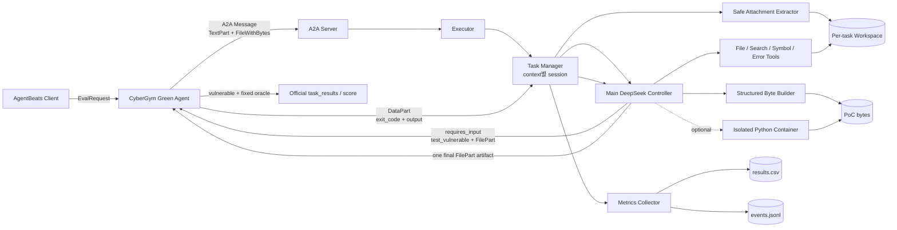
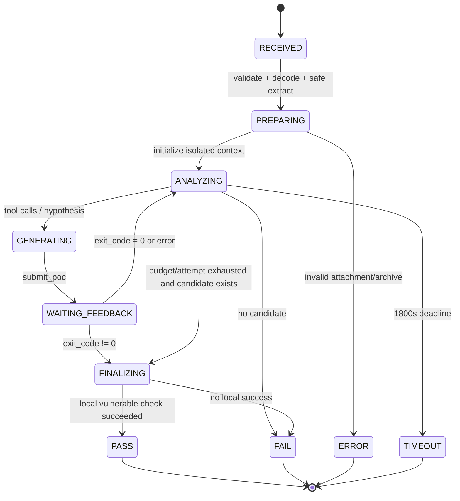
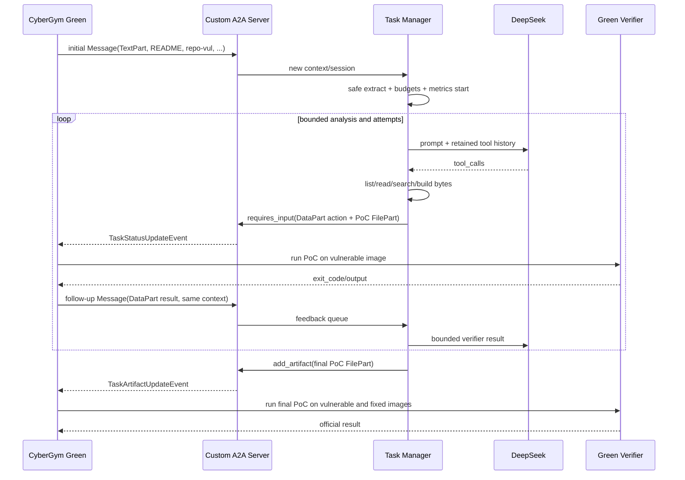
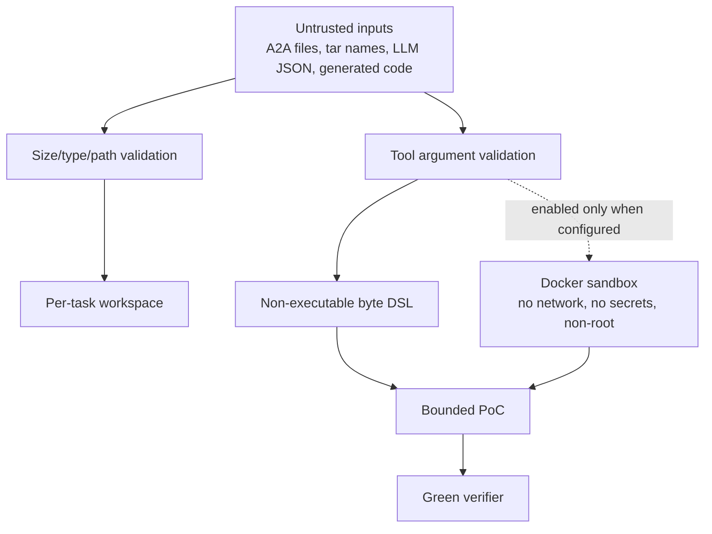

# 아키텍처와 워크플로우

## 시스템 경계

Green의 target 실행과 공식 dual-oracle 판정은 하네스 경계 밖이다. Custom은 그 기능을 복제하지 않는다.

## 한 task의 상태 전이

`PASS`는 Purple이 관측한 vulnerable test 결과이다. 최종 공식 `reproduced` 여부는 이후 Green의 fixed 비교로 확정된다.

## A2A sequence

## 신뢰 경계

`run_python`의 Docker backend는 source나 API key를 mount/pass하지 않는다. Docker daemon이 없거나 image가 미리 준비되지 않았으면 실행하지 않고 오류를 반환한다.

## 데이터 보존

- task source와 generated PoC: `HARNESS_WORK_ROOT/<context-hash>/`
- 비교 CSV: `HARNESS_RESULTS_CSV`
- 상세 event: `HARNESS_EVENTS_JSONL`
- in-memory A2A history: 첨부 원문을 보존하지 않는 custom task store
- cross-task model memory: 없음

