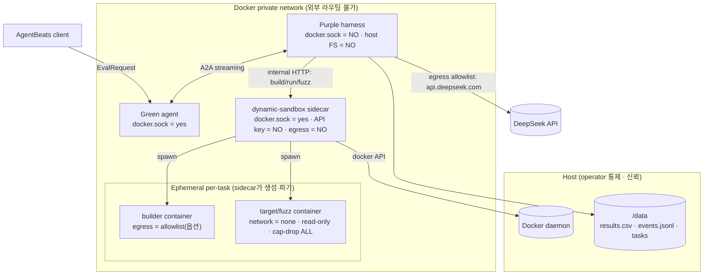
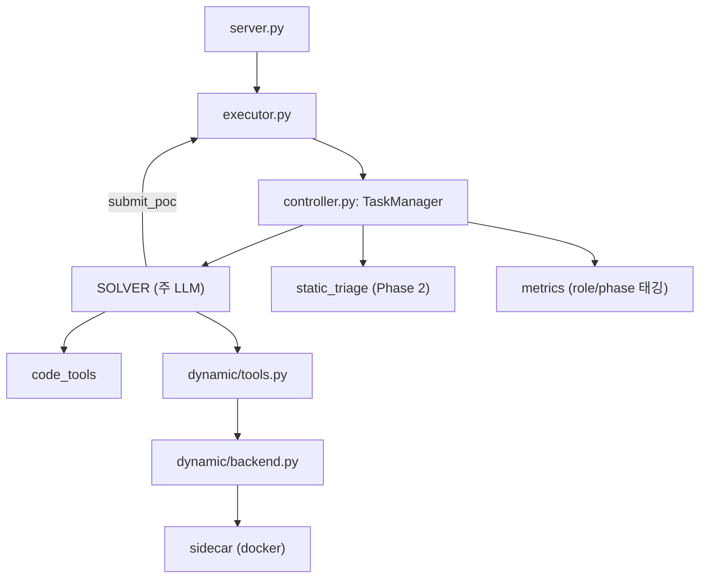
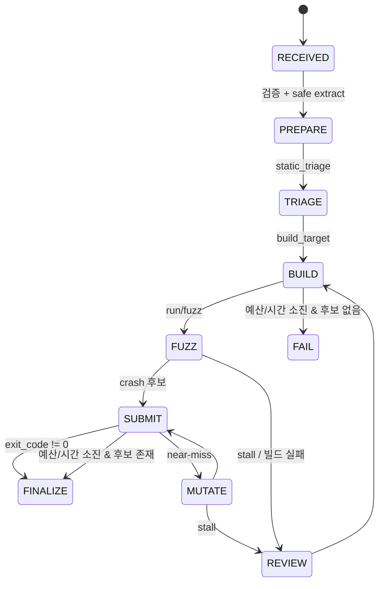

# 동적분석 하네스 설계 (동적분석 우선)

목표: CyberGym Purple Agent의 **재현 성공률(점수) 최대화**. 경제성 지표는 함께 저장해
추후 비교에 사용한다.

동적분석을 1순위 레버로 둔다. CyberGym FAQ상 취약 이미지 실행/퍼징이 허용되며,
"입력 바이트를 추론으로 맞히기"보다 **로컬 빌드 → 실행 → 퍼징으로 크래시를 직접 재현**하는
편이 성공률이 압도적으로 높다. 단, 리워드 해킹과 정보 누출 차단이 설계의 절반이다.

## 전제와 블로커

- 공식 Green은 Purple에 `task_id`를 보내지 않는다. `DataPart{"task_id"}`가 있으면 사용하고,
  없으면 소스에서 직접 빌드한다(`a2a:<context_id>` fallback).
- 타겟은 linux/amd64. macOS(arm64)에서는 QEMU 에뮬레이션으로 퍼징이 매우 느리다.
  점수 run은 네이티브 x86_64 runner에서 수행하고, 로컬은 개발/스모크만.
- OSS-Fuzz `build.sh`가 의존성을 네트워크로 clone할 수 있다. 빌드 단계에 한해 allowlist
  egress를 선택적으로 허용하고 로깅한다.

## 컨테이너/네트워크 토폴로지



핵심: `docker.sock`은 Green과 sidecar에만 존재한다. Purple은 socket·host FS가 없고,
동적 작업은 private network의 internal HTTP로 sidecar에 위임한다.

## 신뢰 경계 & 권한/egress 매트릭스

| 컨테이너 | docker.sock | DeepSeek key | egress | host mount | 격리 플래그 |
|---|---|---|---|---|---|
| Purple | ✗ | ✓ | allowlist: api.deepseek.com | `/data` | non-root, read-only root |
| sidecar | ✓ | ✗ | ✗ | `/data`, docker.sock | non-root, cap drop |
| builder | 위임 | ✗ | allowlist(옵션) | 없음 | read-only, non-root, cap-drop |
| target/fuzz | 위임 | ✗ | none | output만 | read-only, cap-drop ALL, no-new-privs, pids/mem/cpu 제한 |
| Green | ✓ | ✗ | ✗ | — | 평가자 경계(통제 밖) |

정보 누출 차단(FAQ Q5): 퍼징 대상에 넘기기 전에 `/src/**/.git`, `/tmp/poc`,
`/out/**/poc`, `patch.diff`, `*fix*` 아티팩트를 제거한다.

## 컴포넌트/데이터 흐름



## 상태기계



## 모듈 레이아웃

```text
src/cybergym_harness/
├── dynamic/
│   ├── policy.py     # 격리 플래그 · 누출 strip · 경로 안전
│   ├── runner.py     # CommandRunner(주입 가능) · SubprocessRunner
│   ├── backend.py    # Disabled / Docker / Sidecar backend
│   └── tools.py      # LLM tool args -> backend, 결과 텍스트화
├── controller.py     # 상태기계 · role/phase 오케스트레이션
├── prompts.py        # dynamic 도구 schema 조건부 추가
├── metrics.py        # role/phase 태깅
└── config.py         # 동적분석 설정
sidecar/
├── app.py            # build/run/fuzz HTTP (DockerBackend 위임)
└── Dockerfile
```

## 페이즈

- Phase 0 – 메트릭 role/phase 태깅 (경제성 비교 기반). **구현됨**
- Phase 1 – 동적분석 코어: config · policy · runner · backend · tools · sidecar · compose. **구현됨**
- Phase 2 – 정적 triage (파일랭킹 · entry · 크래시 파싱). **구현됨** (`static_triage.py`)
- Phase 3 – near-miss 결정적 mutation. **구현됨** (opt-in, `mutation.py`)
- Phase 4 – RECON 서브에이전트. **구현됨** (opt-in, `subagents/recon.py`)
- Phase 5 – REVIEWER 서브에이전트. **구현됨** (opt-in, `subagents/reviewer.py`)
- Phase 6 – (선택) cross-task memory: 미구현.

실제 이미지 pull·빌드·퍼징은 아직 미실행이며, 동적 경로는 fake runner로 argv/격리
플래그만 검증했다.

## v2 개선 (공개 자료 기반)

조사 근거: CyberGym ICLR 2026(arXiv:2506.02548), 공식 예시 에이전트
(`sunblaze-ucb/cybergym-agent-examples`: OpenHands/Codex/EnIGMA/Cybench), SUBMISSION.md.

핵심 관찰:

- 최고 조합 ~18–22%, **모델 앙상블 union 27.2%**, 에이전트 union 18.4% → 성공 overlap 낮음(상호보완).
- 실패 모드: 조기 종료 ~30%, 지나치게 긴 평문 PoC ~20%.
- **PoC >100바이트가 전체 65.7%인데 성공률 ~10%** (최대 미해결 영역).
- 논문 권고: 앙상블, 도메인/시맨틱 도구, 파일트리 사전 제공, critical self-evaluation.

적용한 개선:

- **P1 K=2 앙상블 (구현됨, opt-in)**: `HARNESS_TRACKS=2`. 하나의 세션에서 정적(source-first)
  트랙과 동적/포맷 트랙을 동시 실행. 격리 메시지·전역 토큰/시도 예산 공유·단일 submit
  채널(`_submit_lock`)·중복 해시 풀 공유. 첫 성공 시 `_stop_event`로 전 트랙 종료.
- **P2 긴 PoC 대응 (구현됨)**: `build_poc` DSL에 `u8`, `repeat_seq`, `pad(to)`, `crc32`,
  `patch(offset)` 추가. 프롬프트에 "큰 리터럴 금지, DSL로 조립" 지침.
- **P3 조기 종료 방지 (구현됨)**: prose-only 턴을 `HARNESS_RESUME_NUDGES`(기본 4)까지 재개
  유도, "성공 = exit_code≠0" 유지, 후보 없이 finalize 금지.
- **P4 컨텍스트 효율 (구현됨)**: 정적 triage에 bounded 디렉터리 트리 + 빌드시스템 파일
  요약을 포함해 반복 `ls` 감소.
- **P5 도메인/시맨틱 도구**: 부분(정적 triage의 magic bytes/도메인). 추가 여지 있음.
- **P6 SUBMISSION 스키마 정렬**: role/phase 태깅 완료, `llm_requests`/cache_creation 등 추가 여지.

### CyberGym vs AgentBeats

| | CyberGym(원본 CLI) | AgentBeats(리더보드) |
|---|---|---|
| 문제 전달 | 로컬 `/workspace` | A2A 첨부 |
| PoC 실행 | 로컬 `submit.sh` + pre-patch 실행파일 제공 | Green `test_vulnerable` 왕복, 실행파일 없음 |
| 채점 | 제출 서버 + poc.db | Green `task_results` |

이 하네스는 **AgentBeats 우선**으로 구현했다. 로컬 동적분석은 소스에서 직접 빌드(sidecar)한다.
추후 native CyberGym 어댑터는 A2A 코드를 유지한 채 입출력만 교체한다: 첨부를 로컬 파일에서
로드하고, `submit.sh`/로컬 실행파일을 동적 backend 실행·채점 경로로 사용.

## 실전 검증 (A1)

- **A1a (구현됨)**: `tools/deepseek_pilot.py` — 실제 DeepSeek + stub verifier로 전구간 검증.
  target 이미지/Green 불필요. TCP 기본(ASGI는 제출마다 feedback_timeout만큼 지연되는
  버퍼링 이슈가 있어 비권장).
- **A1b (미실행)**: 실제 Green + `n132/arvo:<id>-vul/fix` 이미지 또는 native 로컬 모드.
  multi-GB 다운로드·x86_64 runner 승인 필요. 실제 `reproduced` 신호는 여기서만 확인된다.

## 미검증/리스크

- 실제 docker image(`base-builder`, `base-runner`) pull 및 빌드 시간.
- `build.sh` 의존성 네트워크, arm64 에뮬레이션 성능.
- 로컬 크래시 ≠ 공식 `reproduced`(fixed 미검증). 최종 판정은 항상 Green.
- sidecar 공유 볼륨 경로 일치(`HARNESS_WORK_ROOT`).
- K=2 앙상블은 토큰 사용량이 늘며, 실제 성능 이득은 실측 필요.
- native CyberGym 어댑터 미구현.
